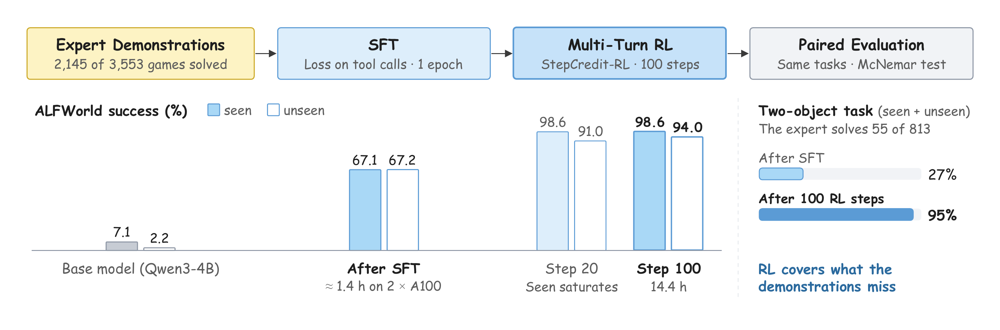
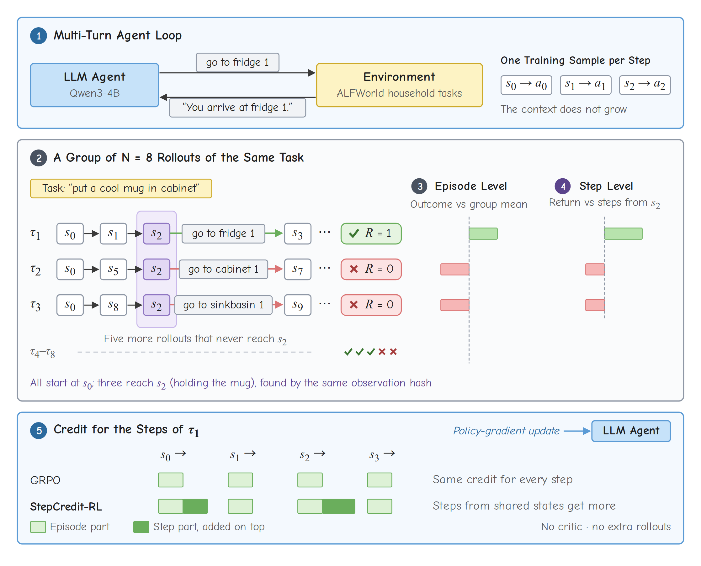

# StepCredit-RL

**SFT → agentic RL for long-horizon, multi-turn tool-calling LLM agents.**

StepCredit-RL trains LLM agents that act over many steps and receive a single outcome reward. The pipeline goes from
expert demonstrations to supervised fine-tuning, multi-turn agentic RL and paired evaluation. It runs on
[veRL](https://github.com/volcengine/verl) with asynchronous [vLLM](https://github.com/vllm-project/vllm) rollouts and
includes tasks for ALFWorld (embodied text games), HotpotQA (multi-hop QA with a local search tool), WebShop and GSM8K
tool use.

Results and analysis are in the [project report](https://hey-chillax.github.io/projects/stepcredit-rl.html).

## Overview

**Pipeline**

1. **Expert demonstrations.** A planner expert plays the ALFWorld training games. Every step of a solved episode
   becomes an SFT example whose prompt is token-identical to the one the RL rollout builds.
2. **SFT.** Fine-tuning on the expert's tool calls gives RL a policy that already succeeds part of the time.
3. **Agentic RL.** The policy interacts with the environment over many turns, and every agent step (one LLM call and
   one tool call) is trained as its own sample [1].
4. **Paired evaluation.** Greedy validation writes per-item records, and an exact McNemar test compares two runs on
   the same items.

<p align="center">
  
</p>

*The pipeline, with ALFWorld success (seen / unseen) after each stage and the training time on 2 × A100. Right: the
two-object task, which the expert rarely solves, goes from 27% after SFT to 95% after 100 RL steps.*

**Training system**

- A Ray driver (veRL) runs rollout, reward, advantage estimation and FSDP policy updates; vLLM servers generate the
  actions of many concurrent agent workers.
- Tasks are plug-ins: an agent flow builds each step's prompt, parses the tool call, steps the environment or tool,
  and returns the next observation and reward.
- Mini-batches keep all steps of a trajectory together, and the policy loss is normalized over the tokens of the batch.

**Algorithms and rewards**

<p align="center">
  
</p>

*StepCredit-RL in one picture (illustration). ① The agent acts through tool calls; each step is one training sample.
② A group of N = 8 rollouts of the same task; s₂ is the same environment state, reached in three of them, and the
other five never reach it. ③ Episode level: each rollout's outcome against the mean of all eight. ④ Step level: the
steps taken from s₂ against the mean return of those steps. ⑤ The two advantages are added for the policy-gradient
update.*

- Trajectory-level group advantages (GRPO, RLOO, REINFORCE) and a step-level relative advantage [4] that compares
  steps taken from the same environment state across rollouts. Both are critic-free; PPO with a critic is supported
  as well.
- Several PPO updates per rollout batch by splitting it into mini-batches.
- Reward shaping for the search agent: token-F1 partial credit, credit for retrieving the gold answer, and a capped
  penalty for repeated queries.
- A loop-aware step reward that penalizes no-op actions in the step-level advantage, and dynamic sampling that rolls
  out extra batches and trains only on prompt groups with a learning signal.
- Training diagnostics: per-step credit, the share of prompt groups without signal, and why trajectories ended.

## Installation

Linux with NVIDIA GPUs, a driver for CUDA 12.8 (≥ 570), and Python 3.12. `uv.lock` pins the environment (verl 0.7.0,
vLLM 0.11.0, PyTorch 2.8.0, flash-attn 2.8.3, ALFWorld, FAISS, ...). From a clone of this repository:

```bash
uv venv --python 3.12 .venv && source .venv/bin/activate
uv export --frozen --no-hashes --all-groups -o requirements.lock.txt
uv pip install -r requirements.lock.txt
```

Run everything from the repository root; there is no package to install.

### Data and models

```bash
modelscope download --dataset Melmaphother/Agent-R1-data --local_dir data   # processed task data and corpus
(cd data/alfworld && unzip -q games.zip)
hf download Qwen/Qwen3-4B-Instruct-2507 --local-dir models/Qwen3-4B-Instruct-2507
hf download BAAI/bge-large-en-v1.5 --local-dir models/bge-large-en-v1.5      # HotpotQA retrieval
```

```text
data/
├── alfworld/          train.parquet  valid_seen.parquet  valid_unseen.parquet  games/
├── hotpotqa/          train.parquet  validation.parquet
├── hotpotqa_corpus/   index.bin  hpqa_corpus.jsonl
└── webshop_full/      train.parquet  test.parquet  goals.json  products.sqlite  lucene_index/
models/
├── Qwen3-4B-Instruct-2507/
└── bge-large-en-v1.5/
```

Other locations work through `DATA_ROOT`, `MODEL_PATH` and the variables listed at the top of `scripts/train.sh`.

## Training

`scripts/train.sh <task> <algo> [Hydra overrides]` launches one run on a single node: 16 prompts × 8 rollouts per
step, 200 steps by default. Outputs, validation records and the offline W&B run go to `outputs/$EXP_NAME/`. Use a new
`EXP_NAME` for every run, because an existing checkpoint under the same name is resumed.

```bash
# Print the composed configuration (no GPU needed)
DRY_RUN=1 bash scripts/train.sh alfworld gigpo

# ALFWorld with the step-level advantage, or with GRPO
EXP_NAME=alfworld_steplevel bash scripts/train.sh alfworld gigpo
EXP_NAME=alfworld_grpo      bash scripts/train.sh alfworld grpo

# Expert demonstrations -> SFT -> RL, in one go
EXP_NAME=alfworld_sft_rl bash scripts/sft_rl_alfworld.sh gigpo

# 4 PPO updates per step
EXP_NAME=alfworld_4updates bash scripts/train.sh alfworld gigpo \
    actor_rollout_ref.actor.ppo_mini_batch_size=4 \
    actor_rollout_ref.actor.clip_ratio_low=0.2 actor_rollout_ref.actor.clip_ratio_high=0.2

# Loop-aware step reward, dynamic sampling
EXP_NAME=alfworld_loop bash scripts/train.sh alfworld gigpo ++algorithm.gigpo.loop_penalty=0.05
EXP_NAME=alfworld_dynsamp bash scripts/train.sh alfworld gigpo \
    ++algorithm.dynamic_sampling.enable=True ++algorithm.dynamic_sampling.max_rollout_batches=3

# HotpotQA search agent with the exact-match reward, or with the shaped reward
EXP_NAME=hotpotqa_em bash scripts/train.sh hotpotqa gigpo
HOTPOTQA_F1_WEIGHT=0.3 HOTPOTQA_EVIDENCE_WEIGHT=0.1 HOTPOTQA_REPEAT_PENALTY=0.05 \
    EXP_NAME=hotpotqa_shaped bash scripts/train.sh hotpotqa gigpo
```

The other tasks are `webshop` (set `JAVA_HOME` to a JDK 21) and `gsm8k_tool`. Any `examples/<task>/run_<algo>.sh`
gives an `<algo>`: `grpo`, `gigpo`, `rloo`, `reinforce`, `gspo`, `ppo`, `steppo`.

On a Slurm cluster, submit the same arguments through `examples/slurm/`:

```bash
mkdir -p outputs/slurm_logs
EXP_NAME=alfworld_steplevel sbatch -p <partition> --time=48:00:00 examples/slurm/train.sh alfworld gigpo
EXP_NAME=alfworld_sft_rl    sbatch -p <partition> examples/slurm/sft_rl_alfworld.sh gigpo
```

## Evaluation

```bash
# Success per split and task family (ALFWorld), or exact match and search behaviour (HotpotQA)
python -m tools.eval_summary outputs/alfworld_steplevel/validation/200.jsonl

# Two runs on the same validation items, with an exact McNemar test
python -m tools.paired_eval outputs/alfworld_steplevel/validation/200.jsonl \
    outputs/alfworld_grpo/validation/200.jsonl --names step-level GRPO
```

`tools/wandb_history.py`, `tools/build_results.py` and `tools/plot_results.py` turn offline W&B runs into the tables
in `results/` and the figures in `assets/`.

Unit tests run on CPU; tests that need verl or the ALFWorld games are skipped when those are missing:

```bash
python -m unittest discover -s tests -t .
ALFWORLD_DATA_ROOT=data/alfworld python -m unittest discover -s tests -t .
```

## Repository structure

```text
agent_r1/          training framework: agent flows, environments and tools, advantage estimators, trainer, workers
recipes/           tasks: alfworld, hotpotqa, webshop, gsm8k, paper_search
examples/          launch scripts per task and algorithm; slurm/ for Slurm clusters
scripts/           train.sh, sft_rl_alfworld.sh
tools/             evaluation, W&B export, result tables, figures
results/ assets/   training and validation metrics, figures
docs/figures/      figures in this README
tests/             unit tests
```

## Acknowledgements

The training framework (`agent_r1/`) and the task recipes (`recipes/`) are adapted from Agent-R1 [1]. Training and
rollouts run on veRL [2] and vLLM [3], the step-level advantage follows GiGPO [4], and the tasks come from
ALFWorld [5] and HotpotQA [6].

1. Cheng et al. [Agent-R1: A Unified and Modular Framework for Agentic Reinforcement Learning](https://arxiv.org/abs/2511.14460). arXiv:2511.14460, 2026.
2. Sheng et al. [HybridFlow: A Flexible and Efficient RLHF Framework](https://arxiv.org/abs/2409.19256) (veRL). EuroSys 2025.
3. Kwon et al. [Efficient Memory Management for Large Language Model Serving with PagedAttention](https://arxiv.org/abs/2309.06180) (vLLM). SOSP 2023.
4. Feng et al. [Group-in-Group Policy Optimization for LLM Agent Training](https://arxiv.org/abs/2505.10978) (GiGPO). NeurIPS 2025.
5. Shridhar et al. [ALFWorld: Aligning Text and Embodied Environments for Interactive Learning](https://arxiv.org/abs/2010.03768). ICLR 2021.
6. Yang et al. [HotpotQA: A Dataset for Diverse, Explainable Multi-hop Question Answering](https://arxiv.org/abs/1809.09600). EMNLP 2018.

## License

MIT, see [LICENSE](LICENSE). Source files with an Apache-2.0 header remain under
[Apache-2.0](LICENSES/Apache-2.0.txt).
